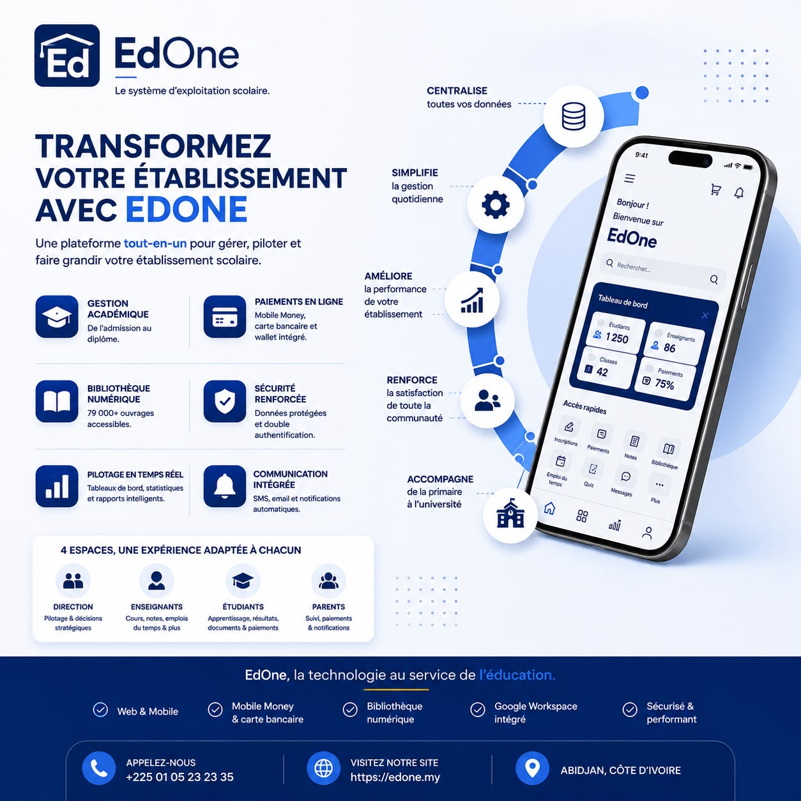

## Référencement technique

`seo-config.json` définit les titres, descriptions et URL canoniques des cinq pages utiles. `scripts/update-seo.py` génère les balises de partage, les données structurées, les icônes liées, `robots.txt`, `sitemap.xml` et `site.webmanifest`. Les pages d’erreur restent hors index. HTTPS est désormais obligatoire sur l’hébergement.

Le catalogue est présent dans le HTML initial. Les principales photos possèdent des variantes WebP, avec repli JPEG. Exécuter `python3 scripts/check-seo.py` pour vérifier les invariants. La procédure Search Console et les limites de la prestation figurent dans `docs/seo-operations.md`.

## Aperçu MacBook et iPhone

La section `#apercu`, placée immédiatement après les chiffres, présente un MacBook et un iPhone en HTML/CSS avec des données de démonstration. Trois vues synchronisées couvrent la vue 360°, l’académique et les finances. `device-showcase.js` gère les compteurs, graphiques et événements simulés, avec pause explicite, suspension hors écran et réduction des mouvements. Les écrans ne sont pas des captures d’un établissement réel et ne présentent pas de données de production.

## Moyens de paiement et aperçu mobile

La section paiements utilise les logos Wave, Orange Money, Moov Money, MTN MoMo et Djamo, avec des fichiers hébergés localement issus des sites officiels (provenance dans `images/payments/README.md`). Visa et Mastercard restent mentionnés en complément.

Le téléphone est un composant HTML/CSS à l’apparence réaliste, avec choix d’opérateur accessible au clavier, montant synchronisé au calculateur et aperçu de reçu. Les données sont fictives, aucune opération de paiement n’est effectuée et aucune donnée sensible n’est demandée. `payment-preview.js` gère cette démonstration. Djamo est ajouté au catalogue des moyens présentés, soit sept avec Visa et Mastercard, sous réserve de disponibilité selon le pays.

## Navigation de pied de page

Le footer commun est défini dans `partials/footer.html` et appliqué aux 20 pages publiques par `python3 scripts/update-footer.py`. Il relie les 18 sections de la page d’accueil, le guide et les pages légales. Les sections détaillées du guide sont regroupées dans un volet dépliable. La synchronisation du catalogue réapplique automatiquement ce footer.

## Film de présentation et informations légales

- `media/edone-presentation-fr.mp4` : motion design original de 35 secondes, avec voix de synthèse française, composition musicale, sous-titres et transcription. Lecteur sans autoplay, muet par défaut, commandes natives et boutons accessibles.
- `scripts/render-motion.py` : source de fabrication du film (macOS, Pillow, FFmpeg et voix Thomas).
- `/mentions-legales/`, `/confidentialite/`, `/cgu/` : pages statiques dédiées au site vitrine, liées dans les pieds de page. La marque publique est EdOne.
- Les éléments d’identité juridique non communiqués restent à compléter ; voir `docs/legal-editorial-notes.md`. Les pages ne remplacent pas les contrats de l’application scolaire.

## Catalogue complet et nouveaux visuels

Le document fourni dans `docs/fonctionnalites-source.md` est la référence métier : 60 entrées numérotées, 8 familles, 6 grands profils, e-mail professionnel et Google Workspace gratuits pour tous, bibliothèque, notifications, documents, ressources, RH et partenaires.

- Frais actuels : **3 % du montant, sans frais fixes additionnels**. Minimum : **2 000 FCFA par transaction**. Le calculateur et toutes les mentions visibles appliquent cette règle.
- `fonctionnalites.html` : guide complet rendu en HTML, consultable sans JavaScript.
- `modules.json` et `docs/roles.json` : données éditoriales de référence. Après une modification, exécuter `python3 scripts/sync-content.py` pour synchroniser `app.js` et le guide.
- `images/enseignante-edone.jpg`, `images/famille-edone.jpg`, `images/bibliotheque-edone.jpg`, `images/administration-edone.jpg`, `images/campus-vie-edone.jpg` : nouveaux visuels illustratifs générés avec ImageGen et optimisés en JPEG. Chargement différé sur la page d’accueil.
- Recherche insensible aux accents, filtres, détails par profil, progression de lecture, apparitions au défilement et effets de survol. Réduction des mouvements respectée.

## Lisibilité et pages d’erreur

Les textes ont été agrandis (descriptions 16–18 px, champs de formulaire 16 px) et les grilles adaptées à ces nouvelles tailles.

Pages disponibles : `400.html`, `401.html`, `403.html`, `404.html`, `405.html`, `408.html`, `410.html`, `422.html`, `429.html`, `500.html`, `502.html`, `503.html`, `504.html`, `offline.html`, `maintenance.html`. Elles partagent `styles.css`, `error.css` et `error.js`, avec retour à l’accueil, contact et bouton de nouvelle tentative lorsque pertinent. Elles sont exclues de l’indexation par une balise robots.

**Hébergement :** le domaine racine est `edone.my` (`CNAME`). GitHub Pages utilise automatiquement `404.html` pour une adresse inexistante. Les autres fichiers sont des pages statiques : leur ouverture directe renvoie normalement HTTP 200. Pour les servir automatiquement avec leurs codes 4xx/5xx, il faut configurer un serveur ou un proxy ; GitHub Pages ne propose pas cette configuration. `offline.html` n’est pas un cache hors connexion : sans service worker installé, elle doit avoir déjà été chargée pour rester visible après une coupure. `maintenance.html` ne met pas le site en maintenance à elle seule.

# EdOne

## Refonte visuelle · octobre 2026

Direction « campus vivant » : fond ivoire, vert profond, accents corail, typographies Manrope et DM Sans. Photo de campus illustrative créée avec ImageGen, illustrations de livres en CSS, animations au défilement respectant la préférence de réduction des mouvements.

- `index.html` : nouvelle page et formulaire de démonstration vers WhatsApp.
- `styles.css` : design responsive, navigation mobile et animations.
- `app.js` : quatre profils interactifs, filtres de fonctionnalités, calculateur de frais, pays et validation du formulaire.
- `modules.json` : catalogue des 60 fiches conservées ; une copie est intégrée dans `app.js` pour permettre l’ouverture directe sans serveur.
- `images/campus-edone.jpg` : nouveau visuel optimisé (environ 460 Ko). Les personnes et les chiffres des aperçus sont illustratifs.

Pour prévisualiser : `python3 -m http.server 4173`, puis ouvrir `http://localhost:4173`. Aucun build ni installation nécessaire. Les polices Google nécessitent Internet ; des polices système prennent le relais hors ligne.

### Le système d'exploitation scolaire · Afrique & Europe

EdOne réunit **gestion académique, scolarité, paiements Mobile Money, bibliothèque numérique, quiz sécurisés, bulletins et diplômes vérifiables** dans une seule plateforme, active dans **25 pays** d'Afrique et d'Europe.

> Fini le carnet papier, les tableurs Excel et les outils qui ne communiquent pas entre eux. Toutes les données de l'établissement sont centralisées, en temps réel, avec des paiements directement intégrés aux flux quotidiens.


---

## 📊 En quelques chiffres

| | |
|---|---|
| **40+** | Modules & fonctionnalités métiers |
| **30+** | Profils & rôles utilisateurs |
| **79 000+** | Ouvrages accessibles en bibliothèque |
| **25** | Pays actifs en Afrique & Europe |
| **15+** | Devises supportées |
| **3 % sans frais fixes** | Frais fixes par paiement en ligne |

---

## 🎓 Fonctionnalités · Pédagogie & vie de classe

- **Gestion académique** : années académiques, campus, salles, filières, niveaux, classes, maquettes pédagogiques
- **Inscription & réinscription** : dossier électronique complet, cartes étudiants, kits & accessoires, statistiques en direct
- **Emploi du temps** : planification par classe, émargements numériques, export PDF/Excel
- **Espace enseignant** : contrats, volume horaire, travaux dirigés, dépôt de supports, RIB, demandes d'acompte
- **Quiz sécurisés anti-triche** : QCM, choix multiples, réponses libres, tentatives limitées, détection de changement d'onglet
- **Devoirs individuels** : dépôt de fichier, consigne jointe, correction et appréciation par l'enseignant
- **Devoirs de groupe** : constitution des groupes, chef de groupe désigné, notation collective
- **Évaluations & notation** : import de notes par Excel, coefficients configurables, gestion des réclamations

---

## 📄 Fonctionnalités · Documents & certification officielle

- **Bulletins** générés automatiquement par semestre (moyennes pondérées, rangs, appréciations)
- **Procès-verbaux** de semestre et annuels, calcul des crédits, décisions de passage automatisées
- **Diplômes & certificats** avec code de vérification publique
- **Attestations de scolarité, de réussite et d'admission**, vérifiables via lien public
- **Reçus de paiement** automatiques, envoyés par SMS et e-mail
- **Carte étudiant** numérique et imprimable, avec photo
- **CV automatique**, généré à partir du parcours de l'étudiant, personnalisable et partageable
- **Vérification en ligne** : chaque document officiel est vérifiable publiquement via son code unique


---

## 💰 Fonctionnalités · Finance, wallet & ressources

- **Comptabilité & scolarité** : frais, plans de paiement, historique complet, statuts de solde
- **Wallet établissement** : solde en temps réel, demandes de reversement, historique des transactions
- **Abonnement & facturation** SaaS automatisée
- **Réconciliation automatique** des transactions, détection d'écarts
- **Stock & moyens généraux** : produits, fournisseurs, commandes, remise de kits
- **Ressources humaines** : fiches personnel, services, contrats, suivi RH
- **Demandes d'acompte** en ligne, validées par la comptabilité
- **Infirmerie** : dossiers médicaux, antécédents, consultations, arrêts de travail

---

## 📢 Fonctionnalités · Communication, sécurité & pilotage

- **Espace parent sécurisé** : accès par matricule, suivi complet du cursus, absences et paiements
- **Campagnes SMS & e-mail** ciblées par classe, filière ou niveau
- **Comptes & permissions** finement configurables par profil
- **Google Workspace intégré** : e-mail professionnel automatique, Drive, Docs, Sheets, Meet
- **Transport scolaire** : cars, trajets, abonnements payables en ligne
- **Double authentification (2FA)** pour les comptes sensibles
- **Dashboard 360°** : vue globale direction (effectifs, recouvrement, RH, académique)
- **Bibliothèque numérique** intégrée



---

## 📚 Bibliothèque numérique · 79 000+ ouvrages

Chaque établissement et ses étudiants accèdent **gratuitement** à une bibliothèque privée enrichie de :
- Catalogue du domaine public (79 000+ titres)
- Documents propres à l'établissement
- Partages entre étudiants, validés par l'administration
- Favoris personnels
- Lecture intégrée sécurisée, sans téléchargement libre

---

## 📈 Tableaux de bord · Web & mobile

- **Dashboard direction (web)** : effectifs, taux de recouvrement, encaissements du mois, enseignants actifs, évolution des inscriptions & paiements, répartition par cycle
- **Applications mobiles dédiées** pour chaque profil :
  - **Espace Parent** · scolarité réglée, absences, échéances, bulletins
  - **Espace Étudiant** · notes, quiz sécurisés, bibliothèque, paiements en attente
  - **Espace Enseignant** · devoirs à corriger, contrats, demandes d'acompte


---

## 💳 Paiements en ligne

EdOne connecte nativement, dans **25 pays** :

**Mobile Money** · Orange Money · MTN Mobile Money · Moov Money · Wave
**Cartes bancaires** · Visa · Mastercard

Frais simples et transparents : **3 % du montant, sans frais fixes**, identiques quel que soit le moyen de paiement.

- Wallet établissement avec demandes de reversement
- Réconciliation automatique de chaque transaction
- Reçu automatique par SMS et e-mail à chaque règlement
- Paiement possible pour la scolarité, le transport, la carte et les kits

**Devises supportées :** XOF · XAF · GHS · NGN · KES · TZS · UGX · RWF · ZMW · MWK · MZN · SLL · ETB · LSL · EUR

---

## 🌍 Couverture géographique

Un seul rail de paiement, **25 pays connectés**, avec un hub opérationnel basé à **Abidjan**.

Côte d'Ivoire · Sénégal · Mali · Guinée · Sierra Leone · Burkina Faso · Ghana · Togo · Bénin · Niger · Nigéria · Tchad · Cameroun · Gabon · Congo · RD Congo · Éthiopie · Ouganda · Kenya · Rwanda · Tanzanie · Zambie · Malawi · Mozambique · Lesotho

---

## 👥 Un espace pour chaque profil

| Profil | Ce qu'il peut faire |
|---|---|
| **Direction & administration** | Multi-établissements, permissions granulaires, diplômes/PV/attestations, wallet & réconciliation, campagnes SMS/e-mail, dashboard 360° |
| **Enseignants** | Contrats, volume horaire, import de notes Excel, quiz & devoirs sécurisés, coefficients, demandes d'acompte, RIB & présence |
| **Étudiants** | Maquette pédagogique, quiz, devoirs, notes, bulletins, paiement Mobile Money/carte, CV auto, bibliothèque, e-mail pro |
| **Parents** | Accès par matricule, suivi cursus/notes/bulletins, alertes d'absences, paiement de la scolarité, notifications SMS/e-mail |


---

## 🔒 Sécurité & conformité

- **Isolation multi-établissement** : chaque requête filtrée, aucune fuite possible entre écoles
- **Chiffrement & HTTPS** : mots de passe hashés, connexions chiffrées de bout en bout
- **Double authentification (2FA)** pour les comptes super administrateurs
- **Sauvegardes automatisées** avec procédure de restauration testée
- **Conformité RGPD**
- **Traçabilité complète** : chaque paiement et modification de note est horodaté et attribué

---

## 🤝 Programme partenaires / affiliation

Devenez fournisseur officiel de la solution EdOne :

1. **Devenez partenaire** · signez l'accord de distribution
2. **Recevez votre licence marque blanche** · déployez EdOne à vos couleurs
3. **Onboardez vos écoles clientes** · installation, formation, accompagnement
4. **Gérez & percevez vos commissions** · depuis votre dashboard partenaire dédié

**Avantages :**
- **100 000 FCFA** de prime d'installation par établissement signé
- **10 % à vie** sur chaque abonnement mensuel payé
- Dashboard partenaire pour piloter tous vos clients
- Support technique & formation dédiés
- Matériel commercial et démo prêts à l'emploi


---

## 💵 Tarifs

| Plan | Prix | Cible |
|---|---|---|
| **Starter** | 25 000 FCFA/mois (~38 EUR) | Jusqu'à 200 étudiants · petites écoles, centres de formation |
| **School** ⭐ | 75 000 FCFA/mois (~115 EUR) | Jusqu'à 800 étudiants · collèges, lycées |
| **Campus** | 200 000 FCFA/mois (~300 EUR) | Jusqu'à 3 000 étudiants · universités, grandes écoles |
| **Enterprise** | Sur devis | Étudiants illimités · groupes scolaires, réseaux & partenaires |

*Frais de transaction (3 % sans frais fixes) identiques quel que soit le plan choisi.*


---

## ❓ FAQ

**Combien coûte un paiement en ligne pour un parent ?**
3 % du montant réglé, sans frais fixes additionnels, quel que soit le moyen de paiement.

**Comment fonctionne la bibliothèque de 79 000 ouvrages ?**
Accès gratuit au catalogue du domaine public, enrichi par les documents de l'école et les partages entre étudiants (validés avant publication).

**Puis-je devenir partenaire et revendre EdOne ?**
Oui, via le programme d'intégrateurs (prime + commission récurrente).

**Quels pays sont couverts pour les paiements ?**
Plus de 25 pays d'Afrique et d'Europe, 15+ devises.

**Nos données sont-elles en sécurité ?**
Oui · isolation totale entre établissements, chiffrement, sauvegardes automatiques, conformité RGPD.

**Combien de temps prend le déploiement ?**
Généralement une à trois semaines, import des données et formation comprises.

---

## 💬 Contact & démo

- **WhatsApp :** [+225 01 05 23 23 35](https://wa.me/2250105232335)
- **E-mail :** edoneapp@gmail.com
- **Adresse :** Abidjan, Cocody Riviera

La page inclut un formulaire de demande de démo qui redirige directement vers WhatsApp avec un message pré-rempli, prêt à être envoyé à l'équipe EdOne.

---

## 🗂️ Fichiers du projet

```
edone_html/
├── images/
│   ├── 1.jpeg     → logo / sceau EdOne
│   ├── 3.jpeg     → support « Voir, pas deviner »
│   ├── 4.jpeg     → support « Infrastructure numérique intégrée »
│   ├── 5.jpeg     → support « Présentation établissement »
│   ├── 6.jpeg     → support « Programme intégrateurs »
│   ├── 9.jpeg     → support « Transformer l'établissement »
│   └── 10.jpeg    → support « La solution intelligente »
├── index.html     → page principale (sans backend)
├── styles.css     → design et adaptation mobile
├── app.js         → interactions et formulaire
├── modules.json   → catalogue des fonctionnalités
└── README.md      → ce document
```

Page 100 % statique : aucune installation, aucun serveur, aucune dépendance externe requise.

---

*EdOne*# edone_html
